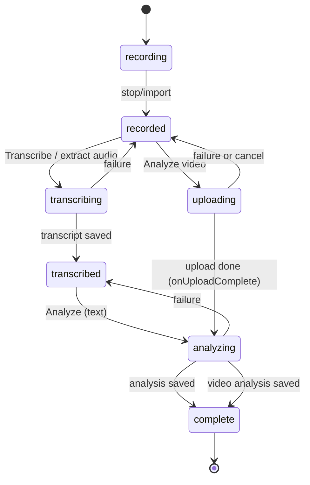
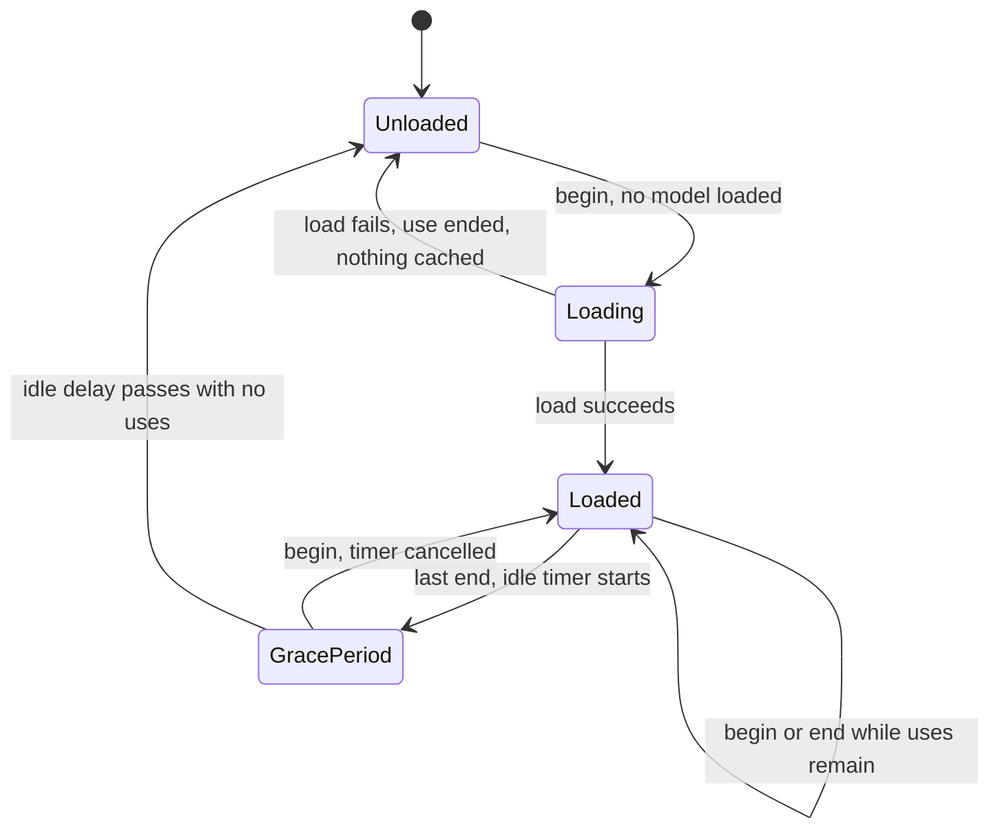

# Lesson workflow

The pipeline is orchestrated by `RecordingDetailView` (private methods `startTranscription`, `startAnalysis(of:...)`, `startVideoAnalysis`, `startAudioExtractionAndTranscription`, `reanalyzeAsNewSession`, `deleteRecording`), which calls services obtained from the [`ServiceContainer`](overview.md). Each service owns one concern and talks to the [Cloud Run API](../backend/cloud-run-api.md) with a bearer token from `AuthService.getValidSession(updating:)` ([auth and config](auth-and-config.md)).

## Inputs

| Input | Service | Rules |
|---|---|---|
| Live recording | `RecordingService` (AVAudioRecorder, level metering, mic permission) | 5-90 minutes (`validateDuration`, `AppConfiguration`); release app needs the `audio-input` entitlement |
| Audio import | `AudioImportService.importAudioFile` | m4a/mp3/wav/aiff/caf; same 5-90 minute bounds (`ImportError`) |
| Video import | `VideoImportService.importVideoFile` | mp4/mov/m4v/webm, `maxFileSize` 10 GB, duration validated; creates `Recording(mediaType: .video, status: .recorded)` reusing the file name for both audio and video paths |

### Capture, import and result views

The entry points live in `ContentView`'s toolbar **Add** menu: New Recording, Import Audio (`fileImporter` filtered by `AudioImportService.supportedTypes`) and Import Video (a sheet hosting `VideoImportView`). New Recording shows `NewRecordingView` in the detail pane. It drives `services.recordingService` for permission, start, stop and cancel, and reads its published `currentDuration` and `audioLevel`. Its own `minDuration`/`maxDuration` constants (5 and 90 minutes) mirror the service bounds; cancelling mid-recording asks for confirmation first. `VideoImportView` previews the chosen file with `NativeVideoPlayer` and shows a 5-20 minute recommendation, which is advisory; the hard checks run in `VideoImportService.importVideoFile`, which it calls before handing the new `Recording` back to `ContentView`.

Inside `RecordingDetailView`, `VideoPlayerView` plays the recording's video when there is one. Once an `Analysis` exists the detail view renders `AnalysisFeedbackView`: summary, strengths and growth areas, technique evaluations (ratings shown only when `Analysis.ratingsIncluded`), next steps, and a **Coaching Chats** card. That card opens `ChatListView` as a sheet; the chat flow itself is documented in [reflection, chat and export](reflection-chat-export.md).

## Status lifecycle

Notes: `recorded`/`transcribed` are the safe resting states; `failed` exists in `RecordingStatus` but the detail-view error paths revert to the last good state instead. On the next launch `Recording.resetInterruptedProcessing` applies the same rule to anything left in `uploading/transcribing/analyzing`, and `Recording.finalizeInterruptedRecordings` settles a session still at `recording` (see [app overview](overview.md)). A recording whose audio file is missing at that point is deleted; the file itself is never removed by launch recovery. Completed sessions offer **Re-analyze**, which makes a new `Recording` copy titled `"<title> (Re-analysis <date>)"` (sharing the media file and copying `segmentsData`/`pausesData`) so the original feedback, reflection and chats are kept; plain re-analysis of a `transcribed` recording, and any new analysis, clears `reflection` and `chatSessions` on the target recording.

## Transcription (on-device)

`TranscriptionService` wraps WhisperKit: `loadModel()` uses `config.whisperModel` (`openai_whisper-large-v3`, downloaded on demand) or, when `DEV_USE_BUNDLED_MODEL=1` and a bundled folder is found, `openai_whisper-base`. `transcribe` runs `DecodingOptions(language: "en", wordTimestamps: true, chunkingStrategy: .vad)`, maps results to `TranscriptSegment`s (confidence = `exp(avgLogprob)`), and derives `TranscriptPause`s with `detectPauses(in:threshold:)` where `pauseThreshold = 3.0` s (`preceding`/`following` text are 5-word snippets). `detectPauses` is `nonisolated static` so stored segments can be reprocessed without Whisper (`backfillMissingPauses`). Progress comes from a 0.5 s timer polling `whisperKit.progress`. Bundled model files are in an ignored resources path and are not documented here.

### Model residency (idle unloading)

The Whisper model is several GB, so `TranscriptionService` does not keep it for the app's lifetime. Its `model` property is an `IdleUnloader<WhisperKit>` built with a 5-minute `idleDelay` around `loadModel()`. `transcribe` calls `model.begin()` before any work and `model.end()` in a `defer`, so the countdown starts however the transcription exits. `IdleUnloader` (in the same file, generic over `Resource`, `@MainActor`) has these rules:

- Concurrent `begin()` calls share one in-flight load.
- A `begin()` during the grace period reuses the loaded model and cancels the pending unload.
- The model is released only when the last use ends and the delay passes with no new use.
- A failed load ends its own use inside `begin()` and is not cached, so the next use retries.

Caption: `IdleUnloader` residency states for the WhisperKit model. `TranscriptionService.transcribe` drives it through `begin()` and `end()`.

Tests: `PauseDetectionTests` (gap at/above threshold detected, below ignored, unsorted input ordered, single segment none), `PauseBackfillTests` (backfill only when missing, idempotent). `IdleUnloaderTests` pins the residency rules: `testUnloadsAfterTheIdleDelay`, `testAUseDuringTheGracePeriodReusesTheModel`, `testConcurrentUsesShareOneLoad`, `testItStaysLoadedUntilTheLastUseEnds`, `testAFailedLoadEndsItsUseAndTheNextUseRetries`, `testReloadsAfterUnloading`. These use short delays, so they run quickly without WhisperKit.

## Text analysis

`AnalysisService.analyze` POSTs `{transcript, techniques[{id,name,description,lookFors,exemplarPhrases}], includeRatings, pauseData}` to `/analyze` (300 s timeout; `pauseData` is nil when there are no pauses). It decodes the snake_case reply into `Analysis` + `TechniqueEvaluation`s (matching technique names by id). Status mapping: 200 ok; 429 `rateLimited`; 401/403 auth failure; 5xx `serviceUnavailable`. The backend limits (100k-char transcript, 20 techniques, 100 pauses) are in [Cloud Run API](../backend/cloud-run-api.md). After success the caller stores `analysis.frameworkId = framework.rawValue`, which the [Growth dashboard](growth-dashboard.md) filters on.

## Video analysis

`VideoAnalysisMethod` offers `geminiVideo` ("Video Analysis", ~$0.15-0.27) or `geminiText` ("Audio Only", ~$0.01-0.03). The video path (compress -> Cloud Storage upload -> `/analyze/video`) is detailed in the [video analysis pipeline](../backend/video-analysis-pipeline.md); its `/analyze/video` request uses a 600 s timeout (`VideoAnalysisService`, versus 300 s for text analysis). In `startVideoAnalysis` the analysis and an **on-device transcript extraction** (`AudioExtractionService` -> `TranscriptionService`) run in parallel; the analysis is saved immediately and `status` becomes `complete` without waiting, and the transcript is attached later best-effort (needed for chat; chat extracts it on demand for video-only recordings). Errors with `offersTranscriptFallback` set `videoFallbackMessage` instead of an alert.

## Media files and cleanup

A `Recording` stores bare file names (`audioFilePath`, `videoFilePath`) that resolve inside the app's `Recordings` folder (`Recording.recordingsDirectory`, under Application Support). All deletion and audio replacement goes through the "Media File Cleanup" extension in `Core/Models/Recording.swift`, not ad-hoc `FileManager` calls:

- `Recording.deleteWithMedia` runs when the teacher deletes a session (`RecordingDetailView.deleteRecording`). It captures both file names, deletes the recording and saves, and removes the files only after the save succeeds.
- `replaceAudioFile(with:in:directory:)` runs after on-device extraction (`RecordingDetailView`, and `ChatPanelView` when chat extracts audio on demand). It points the recording at the new audio, saves, then removes the previous audio file. It never removes the video.
- `Recording.removeUnreferencedMedia` deletes a named file only when no remaining recording uses it as its audio or video. It skips empty names, names containing `/`, `.` and `..`, so nothing outside the folder can be touched. It returns the names it removed.

### Unused-file cleanup (Settings)

Files left behind by older deletes and re-extractions can be reclaimed from **Settings > General > Remove Unused Files…** (`GeneralSettingsTab.findUnusedFiles`). The flow is deliberately conservative:

1. `PersistentStore.hasOtherStore(appSupport:)` runs first. If a set-aside `LessonLens-backup-*.store` or an unreadable/LessonLens `default.store` exists, or the `com.peninsula.lessonlens` folder cannot be listed, the cleanup refuses with a "can't confirm" message, because sessions in that other store still point at these files. See [persistent store](persistent-store.md#other-stores-and-unused-file-cleanup).
2. `Recording.unusedMediaFiles(in:directory:now:)` lists regular files in `Recordings/` that no recording uses as audio or video, with their sizes. It skips anything modified or attribute-changed in the last 10 minutes (a recording, import or extraction may still be writing it, or its session is not saved yet), so a freshly copied import whose source had an old modification date is not offered. Folders are skipped. It returns nil when the folder or the recordings cannot be read, and the UI then reports that nothing was removed.
3. The teacher confirms in an alert. `removeUnusedFiles` then recomputes the unused set and removes only names still unused, through `removeUnreferencedMedia`, so a file that came into use while the dialog was open is kept.

Focused tests in `MediaCleanupTests`: `testUnusedFilesAreFoundAndFilesInUseAreNot`, `testRecentFilesAreNotOffered`, `testAFreshImportCopyIsNotOfferedEvenWithAnOldModificationDate`, `testFoldersAreNotOffered`, `testOtherStoreBlocksCleanup`, `testUnlistableFolderBlocksCleanup`. The SwiftUI alert and button are not tested.

Invariants the tests pin (`LessonLensTests/MediaCleanupTests.swift`): a video session's deletion removes both the original video and the extracted audio; re-analysis copies share their original's files, so a shared file survives until its last user is deleted (`testSharedFilesStayUntilTheLastSessionUsingThemIsDeleted`); a new video import uses the video as its own audio until extraction, and replacing it must keep the video (`testFirstExtractionKeepsTheVideoItReplacesAsAudio`). Store-level file recovery is a separate concern; see [persistent store](persistent-store.md).

Change guidance: a file is only protected from cleanup while a saved `Recording` references it or it was touched in the last 10 minutes, so any new code that writes into `Recordings/` must save the referencing recording promptly. Do not add a cleanup path that skips `hasOtherStore`, since sessions in a set-aside store still reference these files.

## Change guidance

- Adding a pipeline step: keep status transitions reversible and add the new processing status to `RecordingStatus.isProcessing` and `statusAfterInterruptedProcessing`, otherwise launch recovery will miss it.
- Changing the request/response shape with the backend: update `AnalysisService`/`VideoAnalysisService` Codable structs, the route mappers, and [shared prompts](../backend/shared-prompts.md) together; `VideoAnalysisServiceTests` has request-body and status-mapping tests, there is no equivalent for `AnalysisService`.
- Long transcriptions or Whisper behaviour cannot be exercised in CI (WhisperKit models, macOS); rely on the pure static helpers for unit tests.
- Changing when the model is loaded or released: edit `IdleUnloader` or its use in `TranscriptionService.transcribe`, not `loadModel()` alone. Validate with `xcodebuild -quiet -project LessonLens/LessonLens.xcodeproj -scheme LessonLens -destination 'platform=macOS' CODE_SIGNING_ALLOWED=NO test -only-testing:LessonLensTests/IdleUnloaderTests` (macOS and Xcode only; it is not in CI).
- Keep copy "coaching, not evaluation" in any user-visible message you touch.
