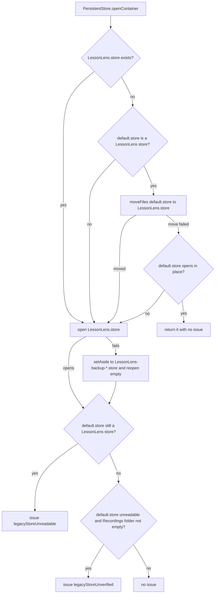

# Persistent store location, migration and recovery

The SwiftData store holds every teacher's recordings, transcripts, analyses and reflections, and it exists only on that Mac. `PersistentStore` in `App/LessonLensApp.swift` is the only code that decides where the store lives and what happens when it cannot be opened. It moves and renames files, but it never deletes them. The schema itself is listed in [app overview](overview.md); this page covers the file-level behaviour around it.

**Consult this page when** changing a `@Model` schema, the store folder name, the migration path from the older `default.store`, or any launch-time storage notice.

## Locations

| Item | Path (under `~/Library/Application Support/`) | Source |
|---|---|---|
| Store | `com.peninsula.lessonlens/LessonLens.store` (plus `-shm`, `-wal`) | `PersistentStore.storeURL(in:)`, `folderName`, `storeName` |
| Legacy store | `default.store` (SwiftData's default name, used through v1.2.0) | `PersistentStore.legacyStoreURL(in:)`, `legacyStoreName` |
| Recordings | `com.peninsula.lessonlens/Recordings/` | media paths in `Core/Models/Recording.swift` |
| Set-aside backups | `com.peninsula.lessonlens/LessonLens-backup-yyyyMMdd-HHmmss.store` | `PersistentStore.setAside` |

Release builds are not sandboxed, so the legacy file sits in the shared Application Support root (see [deployment and release](../operations/deployment-and-release.md)). The only build-context branch is the XCTest check in `sharedModelContainer`, which uses an in-memory container. Debug builds use the sandboxed entitlements, and the paths are still resolved through `FileManager`'s Application Support lookup.

## Opening the store

*Order matters: the legacy move runs before the store is opened, and a failed open is set aside rather than deleted. The notice is decided after the store opens.*

- **Move-in is conditional.** `default.store` is moved only when `LessonLens.store` does not exist yet and `isLessonLensStoreFile` confirms the file is LessonLens's. `isLessonLensStore` reads the SQLite metadata (without opening the store) and checks for `Recording` and `Transcript` entities, so another app's `default.store` is left byte-for-byte unchanged.
- **Failed moves roll back.** `moveFiles` moves the main store file, `-shm` and `-wal` in order and moves already-moved files back if one step fails. If the move fails and the legacy file still opens, the app works from it for that launch, and the move is retried next launch; no empty store is created at the new path, because it would stop the retry. If the legacy file cannot be opened either, the code falls through to the normal open path and creates an empty `LessonLens.store`; the legacy file is still present, so `legacyStoreUnreadable` is raised when its metadata still identifies it as LessonLens data.
- **Failed opens are set aside.** If `LessonLens.store` cannot be opened, `setAside` renames all three files to `LessonLens-backup-<timestamp>.store` in the same folder and an empty store is created. If the rename itself throws, `openContainer` throws and `LessonLensApp.sharedModelContainer` calls `fatalError`, so the app never runs on a temporary store that would lose new sessions.

## Launch notices

`openContainer` returns an optional `StorageError` alongside the container. `LessonLensApp` stores it in `PersistentStore.launchIssue`; the main window's `onAppear` clears it and passes it to `AppState.handleError(.storage(issue))`, so it is shown once per launch.

| Case | When it is raised | Teacher-facing meaning |
|---|---|---|
| `storeSetAside(backupName:)` | the current store failed to open and was renamed | sessions were kept in the named backup; the library starts empty |
| `legacyStoreUnreadable` | a LessonLens `default.store` is still present after launch | older sessions exist but are not shown; the file was left in place |
| `legacyStoreUnverified` | `default.store` cannot be read as a store and the `Recordings` folder is non-empty | an older library file was not checked; it was left unchanged |

`legacyStoreUnverified` is only raised when the Recordings folder shows that LessonLens was used on this Mac, because an unreadable file alone may belong to another app. Both legacy cases repeat on every launch until the file is resolved.

## Tests

`LessonLens/LessonLensTests/PersistentStoreTests.swift` runs against temporary directories, not the real Application Support folder. Use these test names to find each rule:

- Location and fresh install: `testStoreLivesInTheAppFolder`, `testFreshInstallOpensAnEmptyStoreInTheAppFolder`.
- Legacy migration: `testLessonLensLegacyStoreMovesWithItsSessions` (files move together), `testFailedMoveKeepsWorkingFromTheLegacyStore` (failed move, no empty store created).
- Another app's store: `testAnotherAppsDefaultStoreIsLeftAlone`, `testUnreadableLegacyFileIsLeftUnchanged`.
- Precedence and notices: `testExistingStoreInTheAppFolderWinsOverALegacyStore` (`legacyStoreUnreadable` repeats), `testUnreadableLegacyFileIsFlaggedEachLaunchWhenLessonLensWasUsed` (`legacyStoreUnverified` repeats).
- Recovery without deletion: `testUnreadableStoreIsSetAsideNotDeleted`, `testSetAsideRenamesEveryFileToATimestampedBackup`.

## Change recipes

- **Add or change a `@Model` property:** add it with a default value so SwiftData can migrate in place. Any failed open sends the store down the set-aside path, so the teacher sees an empty library and a backup, not a crash. Also add new model types to the schema list in `LessonLensApp.sharedModelContainer`. Run `PersistentStoreTests` and the other model tests listed in [app overview](overview.md).
- **Change the folder or file name:** update `folderName`/`storeName`, the `Recording` media paths and the Settings label together (see [settings, explainer and legal](settings-and-legal.md)). The current migration only moves `default.store`, so a folder change needs a new move step like the one in `openContainer`.
- **Change a notice:** edit `StorageError.errorDescription`. Keep the "nothing was deleted" wording, since the tests pin the cases, not the text, and the copy is the teacher's only explanation.

## Watch out for

- The Terms text in [settings, explainer and legal](settings-and-legal.md) says local data is kept in "the application's sandboxed storage". The Release build is not sandboxed, so that sentence does not match the shipped build. This page does not change the legal copy; it needs review with the Terms owners.
- `PersistentStore.launchIssue` is a process-wide static. It is consumed on the first `onAppear`, so a new notice needs to be set before the main window appears.
- `isLessonLensStore` depends on SwiftData's metadata key layout. A schema rename of `Recording` or `Transcript` would make LessonLens stop recognising its own legacy store.

## Related

- Launch ordering around this code (`resetInterruptedProcessing` and pause backfill run after the container is built) is in [app overview](overview.md#startup-and-wiring).
- The sandbox decision that drives the unsandboxed Release path is covered in [deployment and release](../operations/deployment-and-release.md).
- Test suite conventions are in [build, test and CI](../operations/build-test-ci.md).
