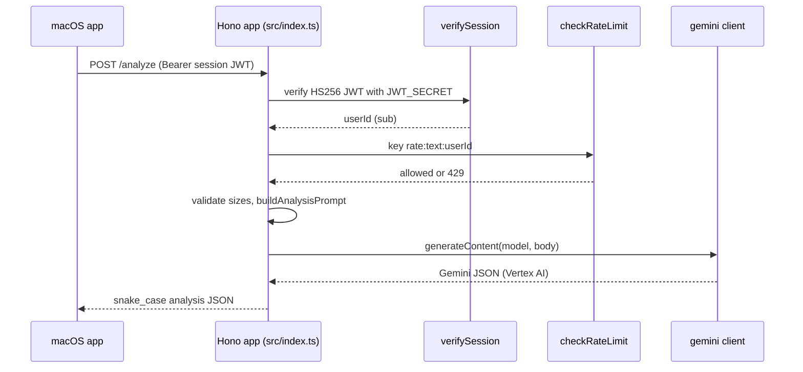

# Cloud Run API

A stateless proxy between the macOS app and Google's Gemini models. It authenticates the teacher, throttles requests, builds prompts from [shared prompt templates](shared-prompts.md), forwards them to Gemini, and reshapes the reply. It stores **no** transcripts, results or sessions - see the privacy invariants in [architecture overview](../architecture/overview.md). Video handling is split out in [video analysis pipeline](video-analysis-pipeline.md). This is the only backend in the repository; the former Cloudflare variant is recorded as removed in [Cloudflare Worker (removed)](cloudflare-worker.md).

**Consult this page when** adding/changing an endpoint, changing sign-in rules, rate limits, model selection, or environment variables.

## Request flow

Every protected route repeats the same sequence: `verifySession(Authorization)` -> `checkRateLimit` (bumps the counter at check time) -> parse JSON -> size validation (per-field caps and the 2 MiB body cap in [input size limits](input-limits.md)) -> prompt build -> `gemini.generateContent` -> response shaping. There is no shared middleware for auth; each route calls `verifySession` itself.

## Endpoints

| Route | File | Notes |
|---|---|---|
| `GET /` | `src/index.ts` | health payload (`name`, `version`, `status`, `runtime: "Cloud Run"`) |
| `POST /auth/validate` | `routes/auth.ts` | Google ID token -> access JWT (7d) + refresh JWT (30d) |
| `POST /auth/refresh` | `routes/auth.ts` | refresh JWT -> new access JWT + refresh JWT with the same `auth_time`; refused (401) once `auth_time` is older than `MAX_SESSION_DAYS` |
| `POST /analyze`, `GET /analyze/rate-limit` | `routes/analyze.ts` | transcript analysis; limits: transcript 100,000 chars, 20 techniques, 100 pauses; temperature 0.4, 8192 output tokens, JSON mime type |
| `POST /analyze/video`, `GET /analyze/video/rate-limit` | `routes/analyze-video.ts` | see [video pipeline](video-analysis-pipeline.md) |
| `POST /upload/initiate/gcs` | `routes/upload.ts` | starts a Cloud Storage resumable upload; see [video pipeline](video-analysis-pipeline.md) |
| `POST /chat`, `GET /chat/rate-limit` | `routes/chat.ts` | coaching chat; max 50 messages, 100,000-char transcript; temperature 0.7, 2048 output tokens; uses `systemInstruction` |

Responses use snake_case (`overall_summary`, `technique_evaluations`, `model_used`, `usage`); the Swift decoders in `AnalysisService`/`VideoAnalysisService` map these via `CodingKeys` (see [lesson workflow](../app/lesson-workflow.md)). Gemini failures return 502 with only `{error, status}` - `describeGeminiError` deliberately logs enum-style status/reason fields, never `error.message` or the body, because those can echo transcript text. The same redaction rule covers the other log paths in `src/gemini-error.ts`: `logUnusableGeminiResponse` logs candidate counts and `finishReason`/`blockReason` enums for replies with no usable text, `readGeminiJson` logs only the parse-error name and reply length when a 200 envelope is not JSON, and `logUnparseableGeminiText` does the same for an unparseable candidate. `tests/gemini-logging.test.ts` (`unusable Gemini replies are logged without their content`) injects a marker string into each kind of bad reply and asserts it never reaches `console.error`; keep that test passing when adding a log line.

## Authentication (`routes/auth.ts`)

- `/auth/validate` verifies the Google ID token with `jose` against Google's JWKS, issuer `accounts.google.com`, **audience = `GOOGLE_CLIENT_ID`**. It then requires `hd === ALLOWED_DOMAIN`, an email whose domain equals `ALLOWED_DOMAIN`, and `email_verified` (defense in depth; failures are 403 and log only the domain, not the email).
- Tokens are HS256 JWTs signed with `JWT_SECRET` (`issueTokens`). Both carry `sub` = Google `sub` and a `token_type` claim: the access token (7d) has `token_type: 'access'` and the `user` object; the refresh token (30d) has `token_type: 'refresh'` and `auth_time` (the time of the last Google sign-in).
- `verifySession` accepts only `token_type: 'access'` with a non-empty `sub`, so a refresh token is rejected on every protected route. It returns `{valid, userId}` from `payload.sub`.
- Legacy tokens: `tokenTypeOf` treats an untyped token as an access token only when its lifetime (`exp - iat`) is 7 days or less, which keeps pre-`token_type` access tokens working until they expire. Untyped refresh tokens (30-day lifetime) are rejected. Remove this fallback once those tokens have expired.
- `/auth/refresh` does not re-check the domain or hit a database. It requires a `token_type: 'refresh'` token with `sub` and a numeric `auth_time`, then refuses (401 "Session expired, sign in again") when `now - auth_time > MAX_SESSION_DAYS`. Because `auth_time` is carried forward unchanged, refreshes cannot extend a session past the cap without a new Google sign-in, which re-checks the domain. The service is stateless, so the old refresh token stays valid until its own expiry; there is no denylist. The response has no `user` field (the Swift `AuthResponse` in `AuthService.swift` declares `user` as required - see [auth and config](../app/auth-and-config.md)).

## Rate limiting (`src/index.ts`)

`rateLimitStore` is an in-process `Map` keyed `rate:text|video|chat:<userId>`, hourly window, defaults 20 / 5 / 50 via `RATE_LIMIT_PER_HOUR`, `VIDEO_RATE_LIMIT_PER_HOUR`, `CHAT_RATE_LIMIT_PER_HOUR`. This is an explicit, commented design decision: resets on restart, not shared across instances, "courtesy throttling" - real protection is auth, Gemini quotas and Cloud Run limits. Read the comment block before changing it; the migration path noted there is Memorystore (Redis). Tests share this store, which is why `tests/test-env.ts` sets `VIDEO_RATE_LIMIT_PER_HOUR=1000`.

**Stale README claim:** `CloudRunBackend/README.md` says rate-limited responses include `X-RateLimit-Limit`, `X-RateLimit-Remaining` and `X-RateLimit-Reset` headers. No file under `CloudRunBackend/src` sets these headers, so do not rely on them or add clients that parse them. Clients read quota state from the `GET .../rate-limit` endpoints (`getRateLimitStatus`). The README's project-structure list is also incomplete (it omits `gcp-auth.ts`, `gemini-client.ts` and `video-storage.ts`); this page's file references are the current ones.

## Gemini client (`gemini-client.ts`, `gcp-auth.ts`)

The Gemini Developer API (API key) path was retired in October 2026 (the `gemini-client.ts` header records this). There is now a single backend: Vertex AI, authenticated as the service's runtime service account.

`createGeminiClient({vertexLocation, auth, fetch?})` returns `generateContent(model, body)`, which posts to `https://<vertexHost(location)>/v1/projects/<project>/locations/<location>/publishers/google/models/<model>:generateContent` with a bearer token. `vertexHost`: `global` -> `aiplatform.googleapis.com`; `us`/`eu` -> `aiplatform.<loc>.rep.googleapis.com` (keeps ML processing in that jurisdiction; the global endpoint does not); otherwise `<loc>-aiplatform.googleapis.com`.

`createMetadataAuth` reads project ID and service-account access token from the Cloud Run metadata server (cached, refreshed 60 s before expiry), so no project identifier lives in source. `src/index.ts` creates one shared client, `gemini`, used by the text, chat and video routes, and `videoStorage`, which uses the same auth object for Cloud Storage. Vertex records each `generateContent` call in Cloud Monitoring; the operator-run [Vertex AI usage report](../operations/vertex-usage-report.md) reads those project-wide totals per model, without any per-request data.

## Environment

| Variable | Default | Purpose |
|---|---|---|
| `JWT_SECRET` | required, >= 32 chars | startup throws otherwise |
| `GOOGLE_CLIENT_ID` | required | startup throws otherwise (without it `jose` would skip the audience check) |
| `MAX_SESSION_DAYS` | `30` | days after the last Google sign-in that `/auth/refresh` keeps issuing tokens; startup throws unless it is a whole number >= 1 (a non-numeric value would disable the cap). README and `docs/DEPLOYMENT.md` describe the same setting |
| `ALLOWED_DOMAIN` | `psd401.net` | server-side domain lock |
| `RATE_LIMIT_PER_HOUR`, `VIDEO_RATE_LIMIT_PER_HOUR`, `CHAT_RATE_LIMIT_PER_HOUR` | `20`, `5`, `50` | per-user hourly limits for text analysis, video and chat (see Rate limiting above) |
| `VERTEX_LOCATION` | `global` | Vertex location; see `vertexHost` above. This is the backend fallback only: `scripts/setup.sh` prompts with `us` and sets the value on the deployed service ([deployment and release](../operations/deployment-and-release.md#district-bootstrap-scripts)) |
| `GEMINI_TEXT_MODEL`, `GEMINI_VIDEO_MODEL` | `gemini-3.8-flash` | model ids |
| `VIDEO_BUCKET` | unset | when empty `videoStorage` is `null` and Cloud Storage routes return 503 |
| `PORT` | `8080` | server port |

`src/index.ts` also installs permissive CORS (documented as intentional: native client only), `X-Content-Type-Options`/`X-Frame-Options` headers, a generic 500 handler and a JSON 404 that echoes the path.

## Change recipes

- **Add a protected endpoint:** create `routes/<name>.ts` exporting a `Hono` router, call `verifySession` first, pick or add a rate-limit key prefix, validate input sizes, build prompts via `shared/prompts`, mount with `app.route(...)` in `src/index.ts`, and add a client call in the Swift service. Add tests next to `tests/video-routes.test.ts` style (fake `globalThis.fetch` standing in for metadata server, Storage and Vertex).
- **Change a request/response field:** update the route, the prompt/JSON schema in [shared prompts](shared-prompts.md) if the model output changes, and the Swift `Codable` models. No second backend needs mirroring; the former worker is no longer maintained ([Cloudflare Worker (removed)](cloudflare-worker.md)).
- **Change token shape, lifetime or session rules:** change `issueTokens`/`tokenTypeOf` and `verifySession` together, keep the access/refresh type separation, and update `tests/auth.test.ts` (it pins these rules). The Swift `AuthResponse`/`SessionToken` must match the response shape ([auth and config](../app/auth-and-config.md)).
- **Add an env var:** extend `Env` and the `env` object in `src/index.ts`; if tests import `src/index.ts`, set it in `tests/test-env.ts` (module is evaluated once per `bun test` run).

## Validation

- Narrow: `cd CloudRunBackend && bun test` (tests: `auth.test.ts` session-token rules, the refresh cap and the `MAX_SESSION_DAYS` startup check; `index.test.ts` HTTP surface/rate limiter/startup validation spawned in a subprocess; `gemini-client.test.ts` Vertex endpoint URL and metadata auth; `gemini-logging.test.ts` log redaction for bad Gemini replies; `input-limits.test.ts` field caps and the 413 body cap; `prompt-builder.test.ts` prompt escaping; `video-routes.test.ts`, `video-storage.test.ts`).
- Log-output change (any new `console.error` that touches a Gemini reply): `cd CloudRunBackend && bun test tests/gemini-logging.test.ts`.
- Auth-only focused check: `cd CloudRunBackend && bun test tests/auth.test.ts`. Its behavior matrix: `describe('verifySession')` covers access acceptance, refresh and untyped rejection, unknown `token_type`, and the 7-day untyped fallback; `describe('POST /auth/refresh')` covers the pair issuance with unchanged `auth_time`, the session-cap 401, and rejection of access, untyped, subject-less and foreign-secret tokens; `describe('MAX_SESSION_DAYS startup validation')` spawns a subprocess to check the non-numeric refusal.
- Conditional: `bun run build` (`bun build src/index.ts --outdir=dist --target=bun`) when imports of `../../../shared` or packaging change; CI runs the org gate per backend dir (see [build, test and CI](../operations/build-test-ci.md)).
- Do not hand-edit `dist/`; there is no committed build output.

