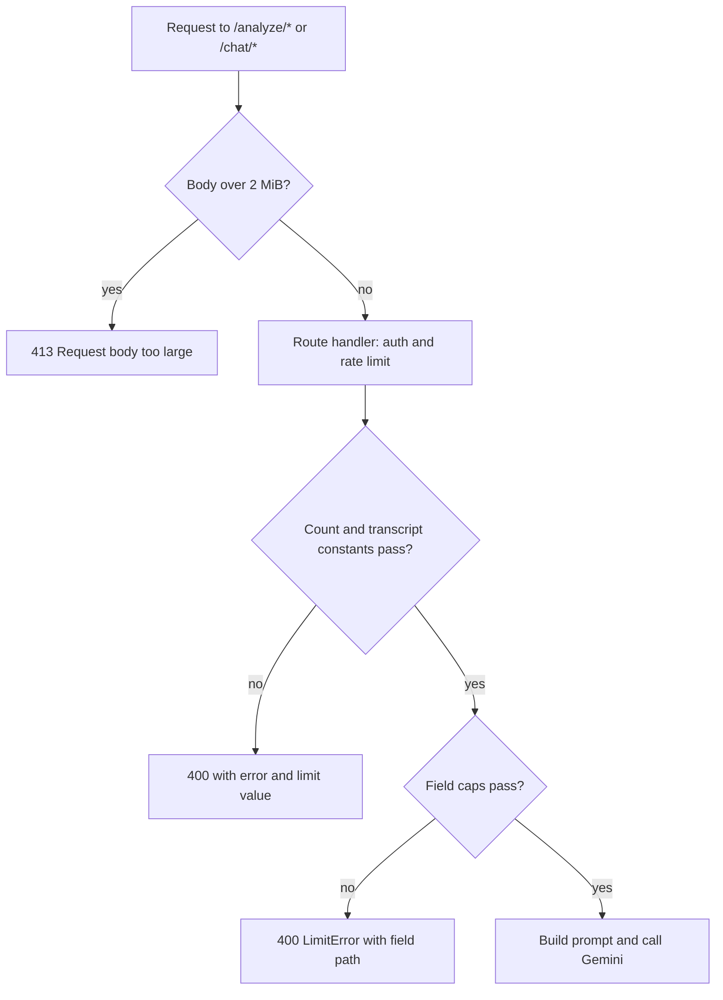

# Backend input size limits

`CloudRunBackend/src/input-limits.ts` is the backend's cost and abuse guard for prompt content (review finding SEC-05). The routes already cap counts (techniques, pauses, chat messages); this module caps the strings inside them, so one authenticated request cannot make an oversized Gemini call. The module's header documents the sizing: the bundled techniques (58 across 7 frameworks, see [frameworks and techniques](../app/frameworks-and-techniques.md)) fit well within the caps, and the largest possible prompt is estimated at about 340k characters for `/analyze` and about 1M for `/chat`.

It belongs to the [Cloud Run API](cloud-run-api.md): the routes listed there call these checkers before they build a prompt with [shared prompts](shared-prompts.md).

**Consult this page when** adding a field to a prompt route, raising a size limit, or changing what the app sends (the app-side sizes the caps were sized against).

## Limits

`LIMITS` is an `as const` object of character or item counts:

| Key | Limit | Applied to |
|---|---|---|
| `techniqueId`, `techniqueName` | 100 | `techniques[i].id`, `.name` |
| `techniqueDescription` | 1,500 | `techniques[i].description` |
| `techniqueListItems` | 12 items | `lookFors`, `exemplarPhrases` count |
| `techniqueListItem` | 300 | each look-for and exemplar phrase |
| `pauseText` | 300 | `pauseData.pauses[i].precedingText` / `followingText` |
| `chatMessage` | 16,000 | `messages[i].content` |
| `analysisSummary` | 40,000 | chat `analysis_summary` (required) |
| `techniqueEvaluationsSummary` | 40,000 | chat `technique_evaluations_summary` (optional) |
| `reflectionSummary` | 20,000 | chat `reflection_summary` (optional) |
| `techniqueNames`, `techniqueNameEntry` | 20 items, 100 each | chat `technique_names` |

`MAX_BODY_BYTES` is `2 * 1024 * 1024`. It is the total body cap for `/analyze/*` and `/chat/*`, and `src/index.ts` registers it with Hono's `bodyLimit` middleware, returning `{error: 'Request body too large', maxBytes}` with status 413.

The transcript and count limits (100,000 characters for transcripts, 20 techniques, 100 pauses, 50 chat messages) are not in `LIMITS`. They are literal constants inside `routes/analyze.ts` and `routes/chat.ts`. Keep this in mind when changing any of them: there are two places to update.

## How the checkers run

Each checker returns `null` when the input fits, or a `LimitError` (`{error, field, maxLength?, maxItems?}`) that the route sends back as a 400 JSON body. `checkString` reports `Missing field` for absent required values, `Field must be a string` for wrong types, and `Field too large`. `checkStringList` reports `Field must be a list` and `Too many items`. The `field` value is the path to the offending value, such as `techniques[0].description` or `messages[3].content`.

| Route | Order inside the handler (after the middleware) | Checker |
|---|---|---|
| `POST /analyze` | auth -> text rate limit -> JSON parse -> required fields -> transcript/technique/pause count and length constants -> field caps | `checkTechniques(techniques) ?? checkPauseText(pauseData)` |
| `POST /analyze/video` | auth -> video rate limit -> JSON parse -> source checks (`gcsObject` ownership, `geminiFileName` format) -> technique count (20) -> field caps | `checkTechniques(techniques)` (see [video analysis pipeline](video-analysis-pipeline.md)) |
| `POST /chat` | auth -> chat rate limit -> JSON parse -> required fields -> transcript and message-count constants -> field caps | `checkChatFields({...})` |

Caption: the order a prompt request passes through before any Gemini call. Rate limiting runs before JSON parsing in the handler, so a request that later fails validation has already used a rate-limit slot.

## Invariants

- **Reject, do not truncate.** The module header states that a silently cut transcript or technique would corrupt the analysis. Every checker returns an error; none trims.
- **No Gemini call on rejection.** Tests assert that the fake `fetch` counter stays at 0 for every rejected case.
- **Body cap precedes handler logic.** Because `bodyLimit` is registered as middleware in `src/index.ts`, an oversized body gets 413 before `verifySession` or `checkRateLimit` runs.
- **Limits are inclusive.** A field exactly at its cap is accepted (`20 techniques at every cap are accepted`, `a request at every cap is accepted`).
- **Checkers do not validate roles.** `checkChatFields` checks `messages[i].content` only; the `role` string is not validated here.

## Tests

`CloudRunBackend/tests/input-limits.test.ts` imports `../src/index` through `./test-env` and posts real requests with a per-request JWT. Its suites:

- `/analyze field caps`: oversized technique description (400 with `maxLength`), too many look-fors, a non-string name, oversized pause text, and the maxed 20-technique acceptance case.
- `/analyze/video field caps`: an oversized technique name is rejected before Gemini (uses `geminiFileName` as the request source).
- `/chat field caps`: oversized message, messages that are not a list, oversized analysis summary and reflection, and the at-every-cap acceptance case.
- `total body cap`: a body of `MAX_BODY_BYTES` characters gets 413 on both `/analyze` and `/chat`.

Run this suite whenever you change a cap; it is the only focused check of these limits.

## Change recipes

- **Add a capped field.** Add a key to `LIMITS`, call the matching checker in the route (or extend `checkTechniques`, `checkPauseText` or `checkChatFields`), and add two tests: a rejection that asserts the `field` path and zero Gemini calls, and an acceptance case at the cap.
- **Raise a limit.** First confirm the app still sends content within the new size; the module header records the bundled technique sizes the caps were chosen from. Then recompute the worst-case prompt estimate in the header and check the request-body implication: `MAX_BODY_BYTES` must stay larger than the sum of field caps the route can receive.
- **Change a count or transcript constant.** Edit the constant in `routes/analyze.ts` or `routes/chat.ts`; these are not in `LIMITS`, so `LIMITS` alone will not change them.

Scope boundaries: rate limiting (per-user counts, in-process store) is in [Cloud Run API](cloud-run-api.md); prompt escaping of user content inside data tags is in [shared prompts](shared-prompts.md) (SEC-06), not in this module; the 2 GB video upload cap is enforced by the app in `VideoAnalysisService` and is not a backend limit.

Validation: `cd CloudRunBackend && bun test tests/input-limits.test.ts` for a focused check; run `bun test` for the full backend suite only when a shared type or route wiring changes. The [build, test and CI](../operations/build-test-ci.md) page lists the whole suite.
